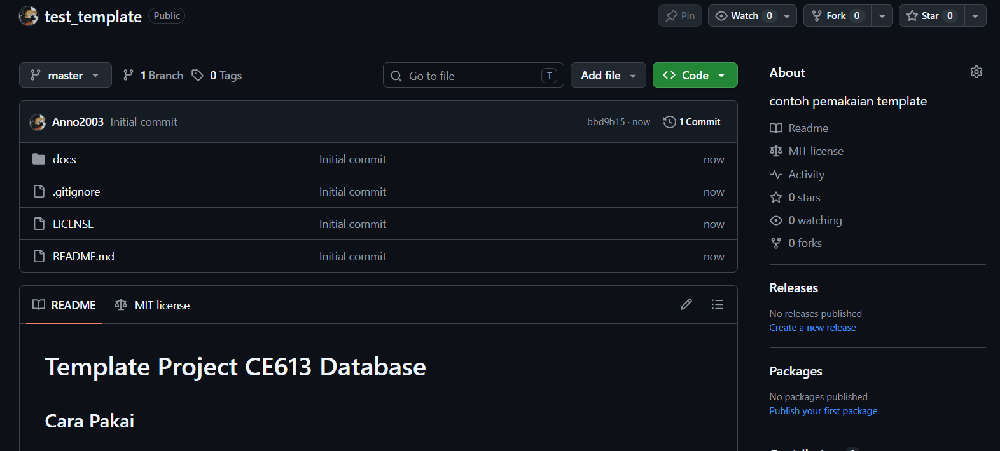
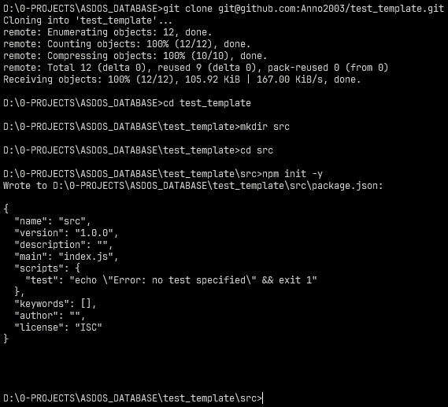

# Template Project CE613 Database

## Cara Pakai
1. klik create template kemudian pilih `Create a new repository`

2. Beri nama untuk repository dan deskripsi sendiri, **pastikan visibility public**, kemudian create repository

3. Repository siap di clone ke komputer lokal

4. Clone repository & setup 
```sh 
git clone <repository-mu>
cd <repository-mu>
mkdir src
cd src
```
**source code project** disimpan di `src/`, berikut contoh dengan menggunakan project nodejs

## Tambahan
- Sintaks dasar markdown cek [link ini](https://www.markdownguide.org/basic-syntax/)
- Cara setup ssh key github  cek [link ini](https://www.petanikode.com/github-ssh/)
- Cara kolaborasi di github cek [link ini](https://uoftcoders.github.io/studyGroup/lessons/git/collaboration/lesson/)
