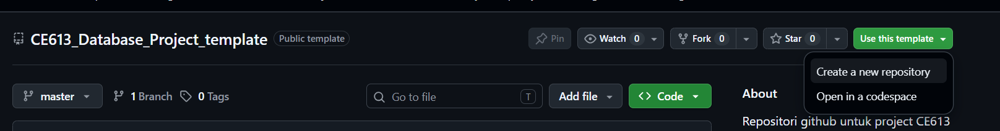
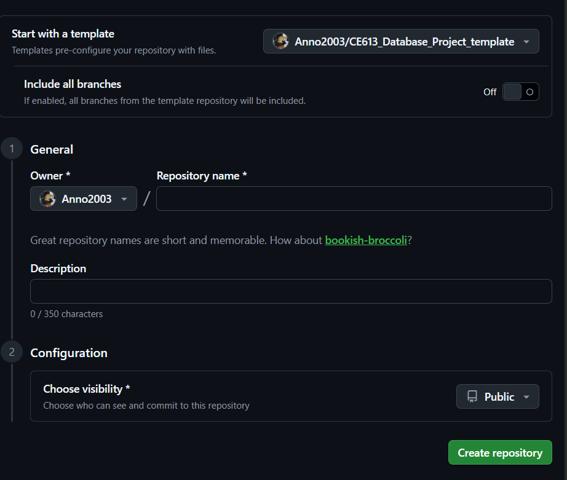

# Template Project CE613 Database

## Cara Pakai
1. klik create template kemudian pilih `Create a new repository`

2. Beri nama untuk repository dan deskripsi sendiri, **pastikan visibility public**
   
